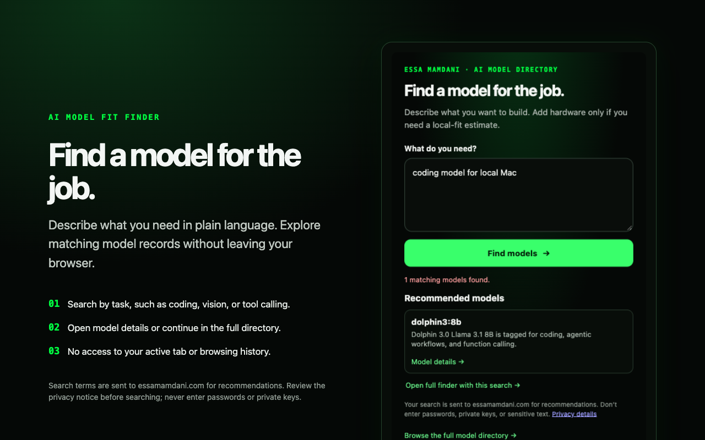

# AI Model Fit Finder

A small Chromium and Firefox extension that searches Essa Mamdani's AI model directory and shows matching model cards in the popup. It does not read the active tab or browsing history. It requests access only to `https://essamamdani.com/*` so it can call the model-search API. Firefox 140 or later is required so Firefox can disclose and ask for consent to transmit search terms.

The screenshot shows a sample result; recommendations vary with the query and current directory data.

## Try it locally

1. In Chrome, open `chrome://extensions` and enable Developer mode. In Firefox, open `about:debugging#/runtime/this-firefox`.
2. Choose **Load unpacked** in Chrome or **Load Temporary Add-on** in Firefox, then select this directory's `manifest.json`.
3. Open the extension, describe a model need, and choose **Find models**.
4. Review matching models in the popup, or open the full finder for hardware-fit estimates.

When you search, the query is sent to the site's model-search API and logged as described in its privacy notice. The server may send the query to its configured AI provider to classify the request. Do not enter passwords, API keys, or other sensitive text. Only the optional full-finder link places the query in a URL.

Read the [AI Model Fit Finder privacy notice](https://essamamdani.com/privacy/ai-model-fit-finder) before using the extension.

The web finder is at [essamamdani.com/ai-models/hardware-fit](https://essamamdani.com/ai-models/hardware-fit); the searchable catalog is at [essamamdani.com/ai-models](https://essamamdani.com/ai-models).

## Download v1.0.1

Get the [packaged extension ZIP](https://github.com/essamamdani/ai-model-fit-finder/releases/download/v1.0.1/ai-model-fit-finder.zip) or read the [release notes](https://github.com/essamamdani/ai-model-fit-finder/releases/tag/v1.0.1). Extract the ZIP, then follow the local installation steps above.

This source build is not yet listed in Chrome Web Store or Firefox Add-ons. Store accounts, listing details, and review are still required before store distribution.
